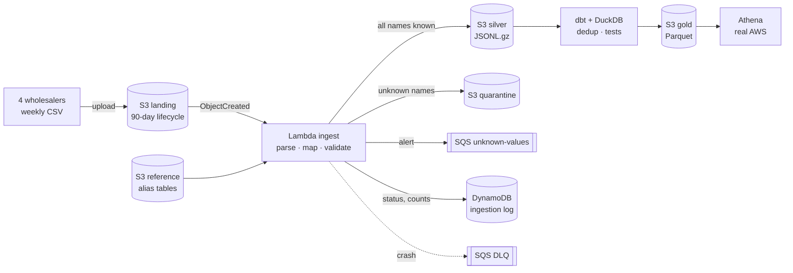

# Pharma Sales Lake on AWS


> Portfolio project: a serverless data lake on **AWS** (S3, Lambda, DynamoDB, SQS, IAM, CloudWatch), deployed with **Terraform**.
> It ingests weekly sales files from four pharmaceutical wholesalers, each with its own format, and builds a deduplicated gold layer with **dbt + DuckDB**, queryable with **Athena**.
> Runs for free on **LocalStack**. The same Terraform code deploys to a real AWS account.
> *Inspired by problems I solved at work. The wholesalers and the data are fictional.*

## The problem

Four wholesalers send a sales file every week. Three things make the numbers lie:

1. **Each one has its own format**:

   | Wholesaler | Separator | Decimals | Date format | Encoding | Price |
   |---|---|---|---|---|---|
   | medipro | `,` | `1250.00` | `2026-07-03` | UTF-8 | unit price |
   | pharmalink | `;` | `1250,00` | `03/07/2026` | UTF-8 | unit price |
   | santeplus | `,` | `1250.00` | `20260703` | UTF-8 | **line total** |
   | distrimed | `;` | `1250,00` | `03/07/2026` | **Windows-1252** | unit price |

2. **Each one names the same drug differently**, and sometimes one wholesaler uses **two spellings for the same drug** (`AMOXICILLINE 250 SUS` / `AMOXICILLINE 250 SUSP`). A pipeline that ignores names it does not know reports totals that look plausible, just too low.
3. **Files are cumulative**: week 38 repeats weeks 27 to 37. Summing every file **overstates revenue about 6 times**.

## Architecture



## What this project demonstrates

- **Infrastructure as code**: every resource is in Terraform, with least-privilege IAM, encryption, public access blocked, a lifecycle rule and log retention. One variable switches between LocalStack and real AWS.
- **Event-driven ingestion**: S3 → Lambda. It is **idempotent**: the ETag is logged in DynamoDB, so the same file sent twice is skipped.
- **All or nothing**: one unknown product or locality rejects the whole file. The file goes to quarantine and an SQS alert says exactly which names to add. Crashes go to a dead-letter queue, with no silent retries.
- **Deduplication of cumulative files**: one row per invoice line, keeping its most recent version.
- **Reconciliation**: for each wholesaler, the gold layer must equal the latest file exactly, in rows and in amount (dbt test).
- **Tested**: 12 pytest tests on the parsing and mapping logic, 11 dbt tests. GitHub Actions deploys the whole stack on LocalStack and runs it end to end on every push.

## Results (generated data)

```
wholesaler   rows_all_files  rows_deduplicated  naive_revenue_m_xof  true_revenue_m_xof  overstatement_x
distrimed             10459               1630                297.2                46.7              6.4
medipro                9073               1413                244.7                39.4              6.2
pharmalink            10780               1654                313.0                48.5              6.5
santeplus              9767               1549                283.1                45.3              6.2
```

When distrimed starts writing `SUSP` instead of `SUS`:

```
landing/distrimed/2026-W32.csv   LOADED    rows=792
landing/distrimed/2026-W33.csv   REJECTED  unknown={"product": {"AMOXICILLINE 250 SUSP": 7, "COTRIMOXAZOLE 240 SUSP": 5, ...}}
```

## Run it (free, no AWS account)

You need Docker Desktop.

```bash
git clone https://github.com/Isac9/pharma-sales-lake-aws.git
cd pharma-sales-lake-aws
docker compose up -d localstack
docker compose run --rm terraform init
docker compose run --rm terraform apply -auto-approve
docker compose run --rm tools python -m lake.generate
docker compose run --rm tools python -m lake.upload
docker compose run --rm tools dbt build --project-dir dbt
docker compose run --rm tools python -m lake.report
```

Try the safety net:

```bash
docker compose run --rm tools python -m lake.generate --new-variant
docker compose run --rm tools python -m lake.upload --wholesaler distrimed
docker compose run --rm tools python -m lake.status
```

## Deploy to real AWS

With your own AWS credentials configured (`aws configure`), and Terraform installed:

```bash
cd infra
terraform init
terraform apply -var localstack=false -var suffix=<something-unique>
```

This also creates a Glue table and an Athena workgroup over the gold Parquet files. Everything stays within the AWS free tier at this volume. Run `terraform destroy` afterwards.
*The real-AWS path is validated by `terraform validate`; the end-to-end run uses LocalStack.*

## Project layout

```
infra/            Terraform: S3, Lambda, IAM, DynamoDB, SQS, CloudWatch (+ Glue/Athena on real AWS)
lambda/ingest/    handler.py (AWS side) and formats.py (pure parsing and mapping logic)
reference/        alias tables: product and locality names → canonical codes
dbt/              silver → gold (dedup) with DuckDB reading and writing S3, tests
tools/lake/       generate files, upload them, status (DynamoDB/SQS), report
tests/            pytest
```
